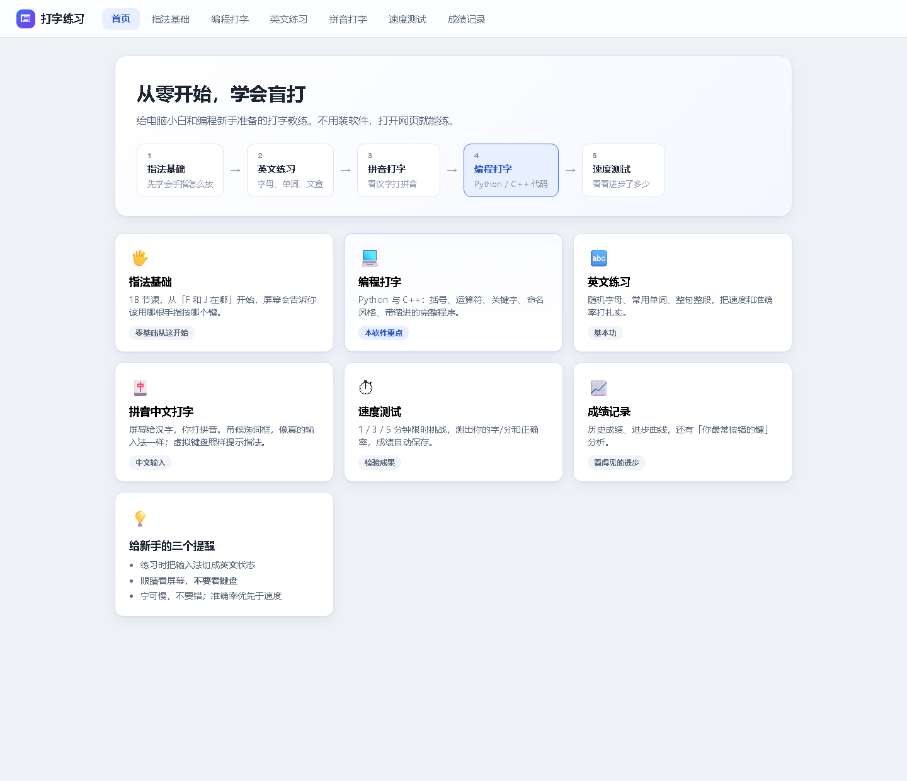
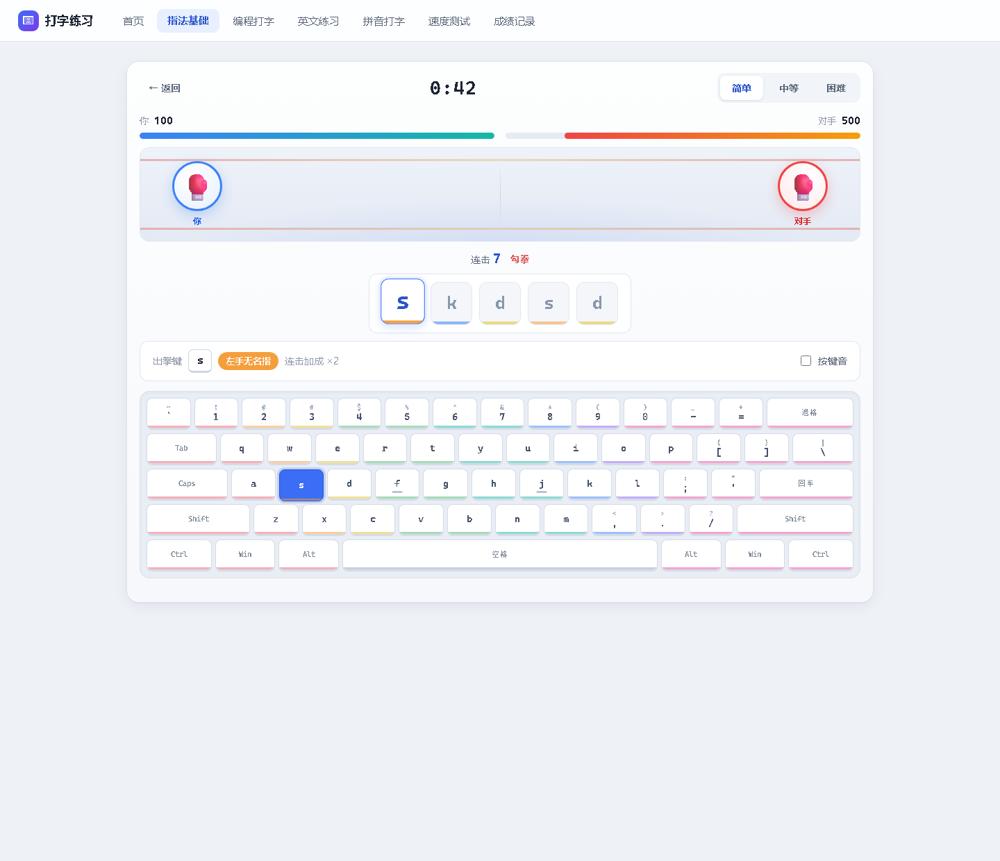
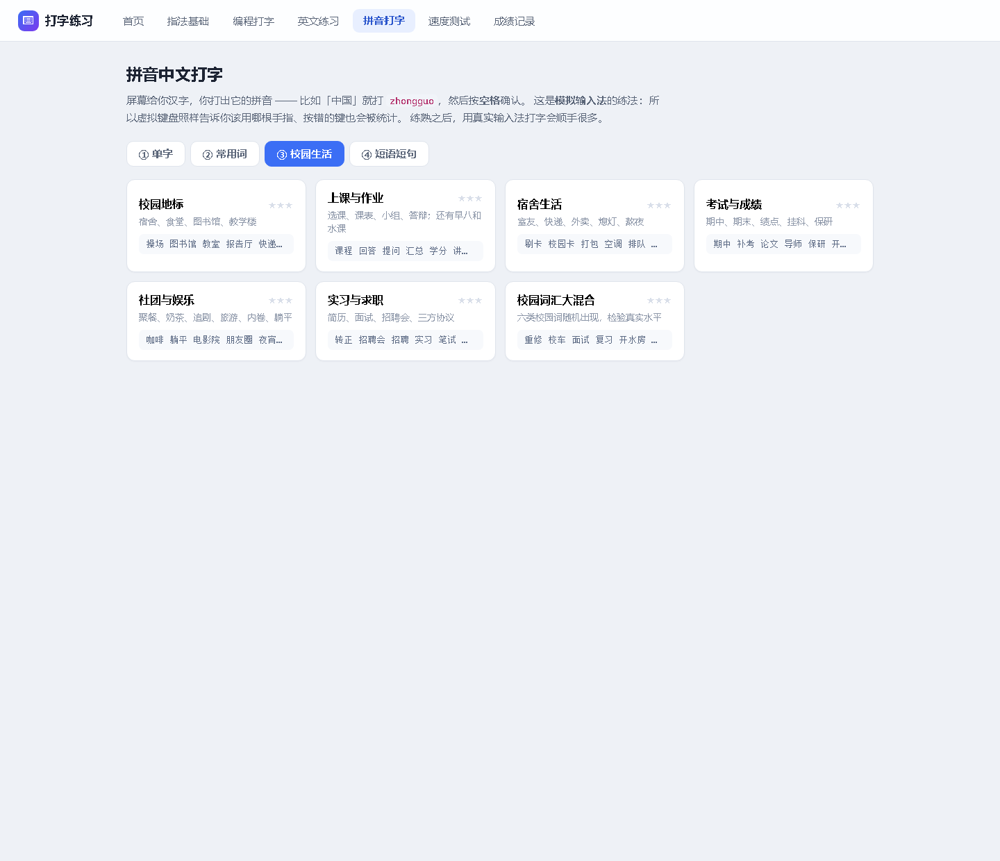
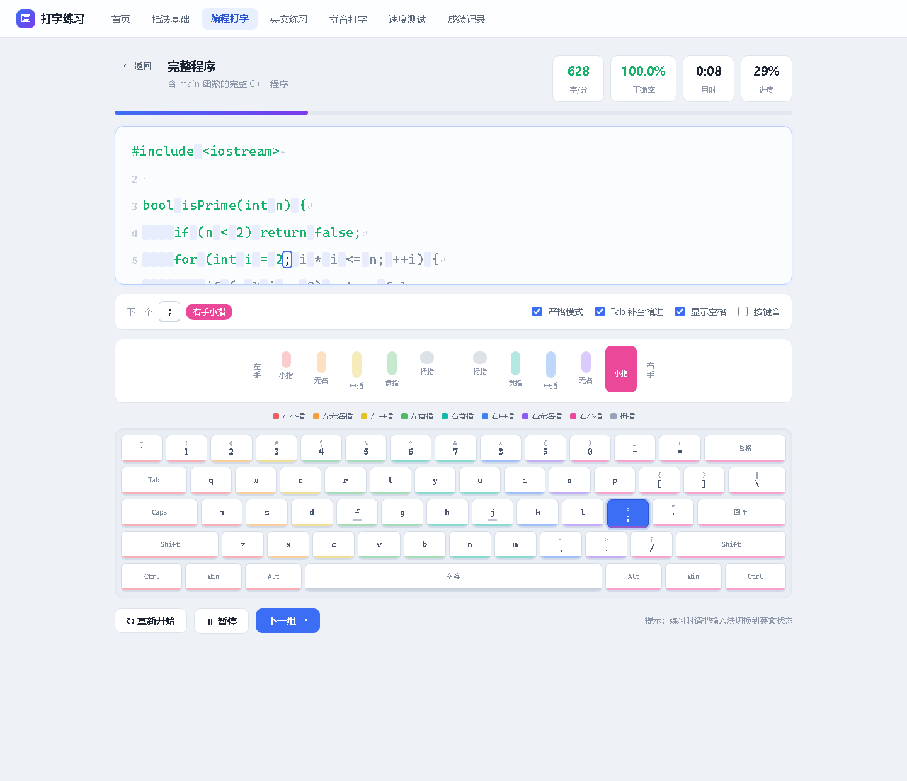
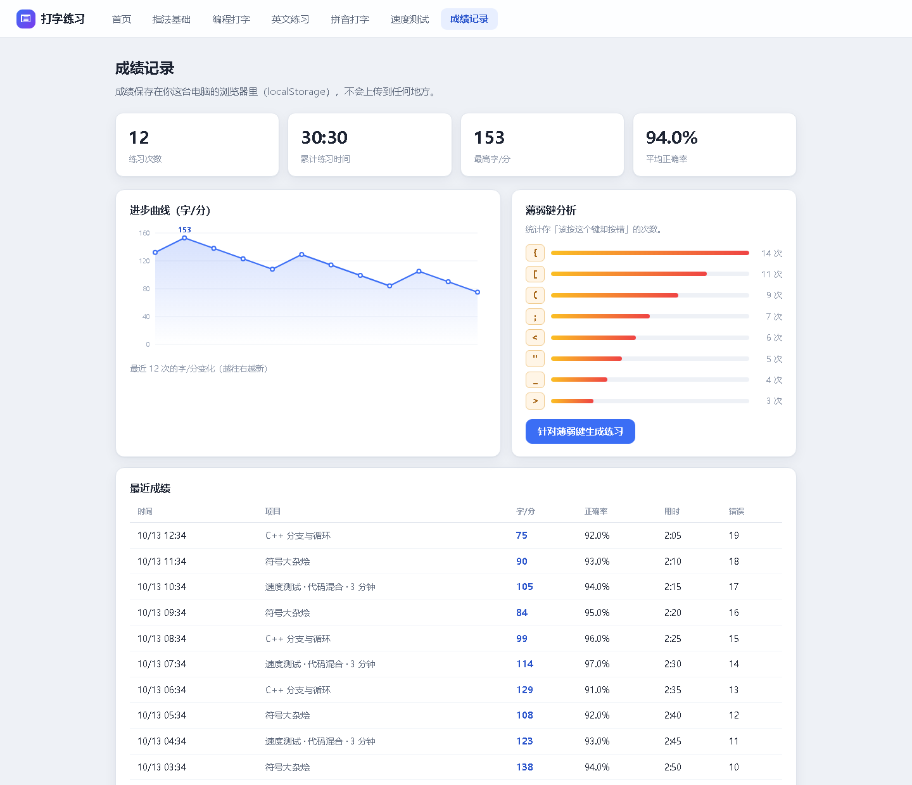

# 打字练习 · 从零到盲打，再到写代码

一个给**电脑小白**和**编程新手**用的打字练习软件。既练中文拼音输入和英文，也练**写代码时真正会卡住手指的那些键** —— `{}` `[]` `()` `;` `::` `->` `&&` `||`，以及 Python / C++ 的缩进。

不用安装任何东西，**双击 `index.html` 就能用**。



---

## 一、怎么打开

1. 找到 `typing-tutor` 文件夹
2. 双击里面的 **`index.html`**
3. 浏览器会打开，直接就能开始练

> 建议用 **Chrome** 或 **Edge** 打开。
> 如果双击后是用记事本打开的，右键 `index.html` → 打开方式 → 选 Chrome。

---

## 二、练什么：一条给新手的路线

软件里有 6 个模块，**建议按顺序来**：

### 1. 指法基础（18 节课，零基础从这开始）
从「F 和 J 上的小凸起是干嘛的」讲起，按 `第1步 → 第4步` 分好组：

| 阶段 | 内容 |
|---|---|
| 第 1 步 · 找到家 | F、J，左手基准键，右手基准键，双手合练 |
| 第 2 步 · 手指上移 | E I、W O、R T U Y、Q P，上排整排 |
| 第 3 步 · 手指下移 | V B N M、C 和 `,`、Z `.` `/`，下排整排 |
| 第 4 步 · 补齐与提速 | G H、26 字母综合、数字键、大写与 Shift、标点 |

**练的时候屏幕上会有三重提示：**
- 虚拟键盘上把该按的键**点亮**
- 下方告诉你**该用哪根手指**（左手暖色、右手冷色）
- 要按 Shift 时，会同时把**另一只手的 Shift** 标成橙色（左手按字母就用右手 Shift，反之亦然）

#### 🥊 拳击训练（指法页顶部的小游戏）



**规则一句话：打对高亮的键就是出拳，打错就被对手反击。**

- 60 秒一回合，三档难度：简单（只打基准键）→ 中等（全部字母）→ 困难（字母 + 数字）
- **连击越长拳越重**：每 5 连加一档倍率，最高 ×5。连击还有名字：刺拳 → 直拳 → 勾拳 → 摆拳 → 上勾拳 → 毁灭重拳
- 打错一次自己掉 6 血、连击清零，对手会打你一记反击拳
- KO 对手获胜；时间到则按**剩余血量比例**判定点数
- 倒计时阶段就会把第一个出拳键亮出来，可以先把手指放好

> **为什么这么设计**：这个游戏练的不是「反应快」，而是「手指准」。
> 打错要付出代价（掉血 + 连击清零），所以想赢就必须按准 —— 和指法课的目标是一致的，不是另搞一套。
> 出拳键**全部不需要按 Shift**，避免把 Shift 的干扰混进指法练习（`tests/selftest.js` 里有一项断言专门守这条）。
> 想调难度就改 `js/boxing.js` 顶部的常量：`BOX_BASE_DAMAGE`（每拳伤害）、`BOX_MISS_DAMAGE`（打错掉血）、
> `BOX_MAX_MULT`（倍率上限）、`BOX_LEVELS`（三档键位池与血量）。

### 2. 英文练习
随机字母 → 高频短词 → 常用单词 → 长单词 → 句子 → 整段文章，共 10 关。练的是手感。

### 3. 拼音中文打字
屏幕给你**汉字**，你打出它的拼音（「中国」就打 `zhongguo`），然后按**空格**确认。这是**模拟输入法**的练法：

- 上方大字是目标汉字，下面一行是它的拼音，**打过的字母会变绿**
- 右侧是**候选词框**，目标词永远排第一个，另外两个干扰项会挑**读音相近**的词（就像真实输入法里你要选的那个）
- 虚拟键盘照样提示指法、统计错键 —— 这是真实输入法做不到的（输入法会把按键吃掉）

共 **4 个标签页、18 关**：

| 标签页 | 内容 |
|---|---|
| ① 单字 | 80 个最常用汉字 |
| ② 常用词 | 生活日常 / 学习与工作 / 电脑与网络 |
| **③ 校园生活** | **校园地标、上课与作业、宿舍生活、考试与成绩、社团与娱乐、实习与求职 + 大混合** |
| ④ 短语短句 | 日常短句 + **校园口语**（「帮我带个饭」「明天要交作业」） |

**③ 校园生活**是为大学生专门加的，收的都是真实校园里每天会打的词：

- 校园地标：宿舍、食堂、图书馆、教学楼、自习室、快递站、开水房…
- 上课与作业：选课、课表、学分、交作业、小组、答辩、**早八**、**水课**、**翘课**…
- 宿舍生活：室友、快递、外卖、排队、刷卡、**熄灯**、**断电**、赖床、值日…
- 考试与成绩：期中、期末、**绩点**、**挂科**、补考、重修、奖学金、**保研**、考研、论文…
- 社团与娱乐：社团、学生会、聚餐、火锅、奶茶、追剧、**内卷**、**躺平**、**摸鱼**、朋友圈…
- 实习与求职：简历、面试、招聘会、笔试、**三方协议**、转正、加班…



> 想练真实输入法？练熟这里的拼音指法，再切到你自己的中文输入法打字，会顺手很多。

### 4. 编程打字 ★ 本软件的重点

分 3 个标签页、共 28 关：

**① 符号与命名**
- 符号基础：圆括号、方括号、花括号、引号与分号、四则运算符、比较与逻辑、**C++ 专属的 `::` `->` `++` `<<` `>>`**、下划线点号冒号、符号大杂烩
- 命名风格：`snake_case` / `camelCase` / `PascalCase` / `MAX_SIZE` 常量 / 四种混合

**② Python**
基础语句 → 列表与字典 → 条件与循环 → 函数与异常 → **完整程序** → Python 关键字

**③ C++**
头文件与基础语句 → 分支与循环 → 函数定义 → STL 常用写法 → 类与结构体 → **完整程序** → C++ 关键字 → 类型与标准库



### 5. 速度测试
1 / 3 / 5 分钟限时，内容可选「代码混合 / 英文文章 / 拼音中文 / 纯符号」。时间到自动结算，成绩自动存起来。

### 6. 成绩记录
- 练习次数、累计时长、最高字/分、平均正确率
- **进步曲线**（最近 40 次的字/分变化）
- **薄弱键分析** —— 统计你「该按某个键却按错」的次数，还能**一键针对薄弱键生成专项练习**
- 最近成绩明细表



---

## 三、几个关键设计（为什么这么设计）

**准确率优先，不是速度优先。**
星级只看正确率：`≥98%` 三星、`≥94%` 两星、打完一星。因为打错再改比打慢更费时间，新手最容易犯的错就是一味求快。

**严格模式（默认开启）**
按错了**不会前进**，必须按对才走。这样手指才会记住正确的键位。想练连贯性可以关掉 —— 关掉后打错会标红但继续往前走。

**Tab 自动补全缩进（默认开启）**
Python 和 C++ 的缩进都是 4 个空格。行首按一下 `Tab`，整段缩进一次性到位，不用数空格。这是新手写代码最烦的事之一。

**显示空格（默认开启）**
空格会显示淡淡的底色。空格数量在代码里是有意义的，看见了才不容易错。

**按错不惩罚退格**
退格回退不额外记一次击键 —— 错误在你打错的那一刻已经记过了，不重复罚。

**光标跟随**
多行代码练习时，当前行会自动保持在可视区域内，不用手动滚动。

---

## 四、练习时请注意

- 把输入法切换到**英文**状态（软件对中文输入法的组字状态做了兼容，但切成英文最顺）
- **眼睛看屏幕，不要看键盘** —— 这是盲打唯一的门槛
- 宁可慢，不要错
- 手指打完离位键后**记得回到基准键**（A S D F / J K L ;）

---

## 五、成绩存在哪

存在**你这台电脑的浏览器里**（localStorage），**不会上传到任何地方**，关掉浏览器再打开还在。

- 「成绩记录」页面底部有「清空全部记录」按钮
- 换浏览器、换电脑，或用无痕模式，记录不会跟过去
- 如果浏览器禁止了本地存储（少数情况），软件会在成绩页顶部给出提示，练习本身仍然可以正常用

---

## 六、给开发者

### 文件结构

```
typing-tutor/
├── index.html            界面骨架（所有屏幕都在这一个页面里）
├── css/style.css         全部样式（含手指配色变量、拳击动效）
├── js/
│   ├── data.js           所有练习内容 + 随机文本生成器
│   ├── keyboard.js       键盘布局、字符→按键映射、手指分工、虚拟键盘渲染
│   ├── engine.js         TypingSession 打字引擎 + TextRenderer 逐字渲染器
│   ├── boxing.js         拳击小游戏（回合、连击、伤害、KO 判定）
│   └── app.js            界面路由、键盘监听、拼音候选词、localStorage 成绩存储
├── tests/                测试 + 截图工具（见下）
└── screenshots/
```

纯原生 HTML/CSS/JS，**零依赖、零构建**，用 `file://` 直接打开即可运行（所以没有用 ES module，全部是普通 `<script>`）。

### 核心接口

```js
// 键盘映射：字符 → 该按哪个键、用哪根手指、要不要 Shift
keyInfoForChar('{')
// → { id: '[', shift: true, shiftId: 'ShiftRight', finger: 'R5', ... }

// 打字引擎
const s = new TypingSession({ target, mode, strict, tabIndent, durationSec,
                              onUpdate, onFinish, onFeedback });
s.press('a');        // 打一个字符，返回是否被消费
s.backspace();       // 退格
s.stats();           // { kpm, accuracy, progress, netChars, keyErrors, ... }

// 拼音关卡：unit() 比 build() 多带回一张「汉字 ↔ 拼音」对照表
pyUnit(PY_LIFE, 14)
// → { items: [{ w:'你好', p:'nihao' }, ...], target: 'nihao xiexie ...' }
pinyinState(items, pos)   // 光标在第几个词、这个词打了几个字母

// 拳击游戏的纯逻辑（脱离 DOM，可直接单测）
boxDamage(7)              // → { mult: 2, dmg: 20 }
boxPunchName(7)           // → '勾拳'
boxDecide(100, 100, 10, 600)  // 点数判定 → true
```

拼音关的 `target` 就是「各词拼音 + 空格」拼起来的普通字符串 —— 所以它**直接复用同一个打字引擎**，指法提示、严格模式、错键统计、成绩记录全都自动生效，不需要单开一套逻辑。界面上的候选词框只是在这条字符串上做了一层投影。

拳击游戏的伤害公式、拳名、点数判定同样抽成了纯函数放在 `boxing.js` 顶部，`Boxing` 对象只负责把它们接到 DOM 上 —— 这样数值平衡是**可测的**，不是靠手感调。

### 跑测试

**引擎与数据自测（250 项断言）** —— 校验 74 个关卡都能生成内容、字符映射表正确、严格/宽松/缩进/退格/暂停各分支、拼音光标定位与词表质量（含重复条目与音节数校验）、拳击伤害与数值平衡：
```bash
node tests/selftest.js
```

**DOM 集成测试（138 项断言）** —— 在真实浏览器里点关卡、派发真实键盘事件、检查候选词框、**打完一整局拳击**、成绩落库和界面状态。用无头 Chrome 跑：
```bash
chrome --headless=new --disable-gpu --allow-file-access-from-files \
       --virtual-time-budget=40000 --dump-dom tests/domtest.html
```
在输出里搜 `PASS` / `FAIL` 即可。拳击那一节要等 3-2-1 倒计时，所以 `--virtual-time-budget` 要给到 40000。

> 改完 `domtest.html` 里的内联脚本，建议先过一遍语法闸门：
> `node --check` 提取出的脚本内容。**内联脚本的语法错误无法被 try/catch 捕获**，
> 会让整个测试静默地停在 `running…`，看起来像卡死。
> 这个闸门已经实际拦下过两次「变量重名导致整个测试静默失败」。

**截图工具** —— 改完界面用它重新出图：
```bash
chrome --headless=new --allow-file-access-from-files --hide-scrollbars \
       --window-size=1440,1240 --virtual-time-budget=20000 \
       --screenshot=screenshots/boxing.png \
       "file:///.../tests/screenshot.html?s=boxing"
```
`?s=` 可选：`home` / `finger` / `code` / `english` / `pinyin` / `pinyin-campus` / `pinyin-word` /
`practice` / `cpp` / `records` / `test` / `boxing`（打到有连击）/ `boxing-count`（停在倒计时）/
`boxing-ko`（打到 KO 出结算面板）

### 加内容

所有题目都在 `js/data.js`，改数组就行：
- 加指法课 → `FINGER_LESSONS`
- 加代码片段 → `PY_PROGRAMS` / `CPP_PROGRAMS` / `CPP_BLOCKS_*`
- 加拼音词 → 写法是紧凑的 `汉字|pinyin`，用空格分隔。现成的词库：
  `PY_CHARS_1` / `PY_CHARS_2`（单字）、`PY_LIFE` / `PY_STUDY` / `PY_TECH`（通用词）、
  `PY_CAMPUS` / `PY_CLASS` / `PY_DORM` / `PY_EXAM` / `PY_FUN` / `PY_CAREER`（校园生活）、
  `PY_PHRASE` / `PY_CAMPUS_PHRASE`（短句）。
  **拼音不用带声调、全小写连写**；加完直接跑一次 `node tests/selftest.js`，
  它会帮你查出重名条目、拼错的字符、以及音节数对不上的地方。
- 加关卡 → `CODE_TRACK` / `PINYIN_TRACK` 的 `tabs[].groups[].levels`
  - 普通关用 `build: () => '文本'`
  - 拼音关用 `unit: () => pyUnit(词库, 个数)`
- 调拳击难度 → `js/boxing.js` 顶部的 `BOX_LEVELS`（每档的键位池、双方血量、时长）
  和 `BOX_BASE_DAMAGE` / `BOX_MISS_DAMAGE` / `BOX_MAX_MULT`。
  改完 `tests/selftest.js` 里的平衡断言会告诉你「打几拳能 KO」，太离谱会直接失败。
- **注意**：代码缩进请统一用 **4 个空格**，不要用 Tab —— `tests/selftest.js` 里有一项断言专门检查这个

---

## 七、已知限制

- 面向**桌面键盘**设计，手机上可以打开但没有意义
- 拼音练习是**模拟输入法**（打拼音字母），不是调用系统输入法。好处是能提示指法、统计错键；代价是练不到「在候选词里选字」这一步
- 拳击游戏只认键盘按键，不支持鼠标 / 触屏操作
- 没有做 Wubi（五笔）
- 多行代码的缩进用 4 个空格（Python/C++ 主流风格）；如果你习惯 Tab 缩进，请先关掉「Tab 补全缩进」再按真实 Tab 练
- 成绩是本地存储，清浏览器数据会一起清掉
